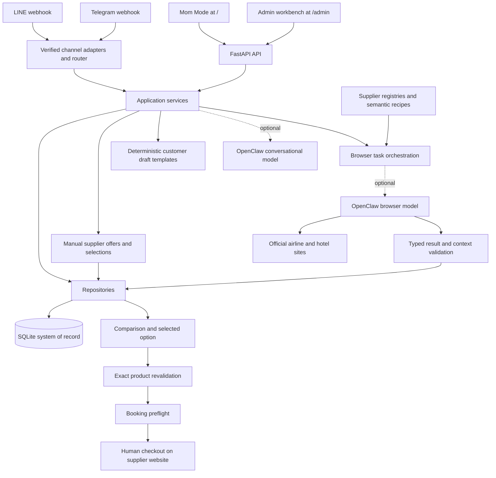

# Mom Travel Desk Developer Architecture

Reviewed: 2026-10-03. Application version: 0.8.1. Audience: engineers maintaining this repository.

Mom Travel Desk is a case-based internal travel-agency prototype. Its strongest implemented foundation is a shared case database with guided intake, typed official-site search workflows, deterministic comparison, and checks before human checkout. The web interface now supports intake, editable case requirements, manual supplier offers, comparison/selection, and editable customer drafts without OpenClaw. Official automation remains optional, and booking preflight stays in the admin/API workflow. This document describes the current implementation; proposed work and review findings are in [the current review](REVIEW_AND_DIRECTION_ZH_TW.md).

## Runtime and implementation map

The app is a Python 3.11+ FastAPI monolith served by Uvicorn. The reviewed environment uses Python 3.12 and the dependency versions in `constraints-tested.txt`. Both interfaces use plain HTML, CSS, and JavaScript; there is no frontend bundler or separate frontend service.



The external agents and live supplier sites were not connected during this review. The diagram shows the integration paths implemented in code, not evidence of a working live deployment.

| Location | Responsibility |
| --- | --- |
| [`app/main.py`](../app/main.py) | Lifespan, middleware, static mounts, API endpoints, webhooks, in-process background searches |
| [`app/config.py`](../app/config.py) | Frozen settings read from environment at import time |
| [`app/models.py`](../app/models.py) | Pydantic request, result, state, and preflight contracts |
| [`app/db.py`](../app/db.py) | Connection lifecycle, schema creation, additive migration markers, audit inserts |
| [`app/repositories.py`](../app/repositories.py) | SQL persistence for cases, sessions, runs, tasks, attempts, events, preferences, and feedback |
| `app/mom_static/` | Default operator UI: today, cases, new customer, intent helper, settings |
| `app/admin_static/` | Legacy workbench, comparison, revalidation, Browser Lab, site trust, approvals |
| `app/services/mom_ux.py`, `guided.py` | Rule-based next action, priority cards, keyword intent routing, six-step intake |
| `app/services/browser_tasks.py`, `browser_result.py` | Task planning/execution and strict output validation |
| `app/services/official_compare.py`, `hotel_compare.py` | Deterministic ranking of validated results, grouped by currency |
| `app/services/*revalidation.py`, `*booking_preflight.py` | Product matching, freshness, changed-condition acceptance, checkout blockers |
| `app/services/openclaw.py`, `replies.py` | Optional backend Gateway client; deterministic offer drafts and general draft fallback |
| `app/workflow_models.py`, `workflow_repository.py`, `services/case_workflow.py` | Manual offer validation/storage, original case context, selection snapshots, official result normalization, local drafts |
| `app/channels/`, `app/services/channel_router.py` | LINE/Telegram verification, allowlists, event deduplication, shared chat routing |
| `app/services/pii.py`, `skill_feedback.py` | Optional encrypted vault; capture and redaction of feedback evidence |
| `app/airlines.py`, `app/hotels.py`, `recipes/` | Official-domain registries and semantic browser instructions |
| `openclaw/` | Intended agent configuration, workspace instructions, and 23 local Skills |
| `app/providers/mock.py`, `scripts/`, `tests/` | Clearly marked synthetic providers, audits, deterministic demos, regression suite |

## Data ownership and persistence

Mom Mode and the admin interface share the same database. A `TripCase` is the root record for a customer trip, but it is not yet a separate customer CRM, passenger manifest, quote, or booking ledger.

| Tables | Stored state and relationships |
| --- | --- |
| `trip_cases` | Customer display name, destination/origin, dates, adult/child/infant counts, optional child ages, budget, notes, status |
| `case_options`, `case_option_selections` | Immutable manual offer records and one selected snapshot per case and kind, with SQL foreign keys to cases |
| `guided_sessions` | Session key, draft answers/index, completion state, eventual case ID |
| `flight_search_runs`, `hotel_search_runs` | Request snapshot, task IDs, aggregate state, selected task/option IDs |
| `browser_tasks` | Supplier URL, instructions, expected schema, raw/typed output, review state, parent references |
| `browser_attempts` | Attempt number, source, timing, validation errors, blocker, result hash |
| `hotel_site_grants` | Exact independent-hotel host, attestation evidence, approval/revocation |
| `approvals` | Action type, summary, amount, decision and timestamps |
| `inbound_events` | Channel/event identity, payload hash, processing lease, saved response, delivery state |
| `user_preferences` | Shared default operator profile: airport, airlines, font size, onboarding |
| `skill_feedback` | Redacted draft/final/note, feedback outcome, local Skill hash, edit ratio, PII flag |
| `audit_log`, `pii_vault`, `schema_migrations` | Audit payloads, optional encrypted sensitive payloads, schema markers |

The logical relationship is case → search run → browser tasks → attempts/results; a selected option belongs to a task, and a revalidation task references its parent task/option. Most relationships are stored as IDs or JSON rather than declared SQL foreign keys. `PRAGMA foreign_keys=ON` alone does not enforce those logical relationships.

SQLite uses WAL, a five-second busy timeout, and a connection wrapper that closes connections after commit/rollback. Startup creates tables, adds selected missing columns, and records migration versions 701, 801 and 802. Migration 802 adds infant/child-age fields and the manual option/selection tables, plus `browser_tasks.result_attempt_id` without dropping existing cases. This is an idempotent POC upgrade mechanism, not a general migration framework. Back up an existing database before first startup; consult [the migration guide](MIGRATION_V071_TO_V081.md).

## Request and workflow behavior

### Guided intake and next action

Intake asks for customer name, destination, departure, return, travelers, and total budget. Answers persist after each step. Dates use ISO format; travelers support shorthand such as `2大1小1嬰兒`. Starting again resumes unfinished intake but resets a completed session for the next customer. Completed shortcuts navigate to real workflows. Typed patches validate the merged record before writes under `BEGIN IMMEDIATE`, including nullability, date order and party composition. Completing intake creates a case and sets it to `quoting`. The session ID persists in browser local storage, whereas the answers live in SQLite.

Next Best Action is deterministic Python logic. It checks case status, missing information, search runs, and selected options. The intent helper uses keyword matching rather than a model. Today priority scoring considers all cases before choosing priority cards; closed cases are excluded. Only displayed cards calculate detailed next actions. It still lacks explicit business deadlines.

### Official-site search and validation

1. Create a flight or hotel request. A run stores the request snapshot and owns one or more tasks.
2. A browser task includes a supplier URL, semantic instructions, and a typed JSON contract.
3. The backend calls the dedicated OpenClaw browser model through `POST /v1/chat/completions` with a 120-second client timeout.
4. Parse and validate the returned contract, including supplier/domain and request context. Invalid output remains subject to review.
5. Store the attempt and result, then refresh the aggregate run state.
6. Compare validated options, select a specific task/option, and create exact-product revalidation.
7. Booking preflight verifies identity, freshness, rules/fees and explicit acceptance of relevant changes before returning readiness for human checkout.

Flight contracts are `flight-search-v1`, `flight-revalidation-v1`, and `booking-preflight-v1`; hotel equivalents are `hotel-search-v1`, `hotel-revalidation-v1`, and `hotel-booking-preflight-v1`. Registered airlines are CI, BR, CX, JX, AE, IT, EK, and NH. Built-in hotel networks are Marriott, Hilton, Hyatt, IHG, Accor, and Shangri-La. Independent hotel domains require a human-approved exact-host grant; known OTA/search domains cannot become official-hotel grants.

`completed` means processing reached a validated terminal state. It may include no results or a manual handoff; it does not imply that a usable option was found. Browser Lab distinguishes contract validity, usable results, and manual handoffs.

Mom Mode displays comparison candidates through the case workflow and lets the operator select an official option, updating the underlying run selection as well. Newly created case-linked searches capture the original case context server-side; changed needs or legacy runs without that context cannot supply an active offer. Revalidation and preflight remain in the admin/API workflow and are not replaced by selecting an option.

### Manual offers and selected snapshots

`POST /api/mom/cases/{case_id}/options` records an immutable operator-entered flight or hotel offer. It requires a positive two-decimal amount, currency, supplier/title, details and conditions, internal source reference, timezone-aware observation time and explicit attestation that the offer covers this case. Child ages must be known for family offers. The amount is a customer reference total, not a supplier-cost ledger. Source URLs may be ordinary HTTP(S) links and do not grant browser trust.

`GET /api/mom/cases/{case_id}/options` combines manual records with validated official comparisons. Result provenance is bound atomically to the exact `result_attempt_id`; legacy results without this evidence and Lab-ingested browser output are labeled demo and cannot be selected for an offer. `POST .../selection` persists one selected snapshot for each kind; `DELETE .../selection/{kind}` clears it. Snapshots are resolved against current evidence before drafting. Changed case needs, expired manual validity, stale official observations, changed content/other-interface selections, demos and missing results prevent offer drafting. All offers use explicit supplier expiry when present; otherwise `QUOTE_MAX_AGE_HOURS` defaults to 24 hours. This quotation window is independent of the stricter 20-minute checkout revalidation policy.

Selections and manual offers persist across browser/server restarts. There is no formal quote versioning, supplier-cost/sale-price separation, PDF export, or booking record in this increment. Capturing/validating an offer does not confirm inventory or execute checkout.

### Background execution

Mom start endpoints schedule FastAPI `BackgroundTasks` and save `running` state. Tasks inside a run execute sequentially. Closing the browser view is safe while the server remains running; process restart does not automatically recover in-flight work. There is no durable queue, worker lease, startup recovery, or transactional claim around the start operation. The check/set sequence also leaves a possible duplicate-start race; concurrent execution was not tested in this review.

A durable job layer is proposed for the pilot, with idempotent claims, worker heartbeats, bounded retries and recovery. FastAPI describes background tasks as work performed after the response and discusses separate queue-backed tools for larger workloads. The durability requirement here follows from this repository's implementation. [FastAPI documentation](https://fastapi.tiangolo.com/tutorial/background-tasks/)

### Drafts and feedback

Customer-reply drafting works without OpenClaw. With selected offers, deterministic templates use structured details, Decimal arithmetic, official-site URLs and Taipei timestamps. Manual supplier names, source references/URLs and raw parser warnings stay out of customer drafts; operator-entered titles/details/conditions must be customer-visible. Mixed currencies are never summed. Invalid selections suppress offer amounts and produce a needs-confirmation reply instead. General drafting may use the optional conversational model; disabled, failed or empty model responses fall back to a local customer-facing template. Local templates are bounded and do not fully interpret arbitrary customer questions.

The UI exposes an editable textarea and copies its current contents, reporting clipboard failure accurately. It collects accepted, edited, prefer-future and rejected feedback. The service applies pattern-based redaction, optionally replaces the bound case name, attributes the record to the SHA-256 of the local Skill, and stores evidence. It does not update live Skills or immediately personalize the next reply. The local file hash does not prove that a separately installed Gateway Skill matches that file. Template feedback is labeled `web_template` and has no OpenClaw Skill hash.

### Channels

LINE verifies the raw-body HMAC signature and operator user allowlist. Telegram verifies its webhook secret and chat allowlist. SQLite event claims support deduplication, collision detection and replay of a saved response after failed delivery. This is not a complete transactional outbox or an exactly-once guarantee across case creation, response storage, and external delivery.

The current router supports menu/intake/radar/case listing. Flight entry redirects to the web interface; hotel entry still uses outdated text saying it is in a future phase. These adapters are groundwork for an internal operator channel, not a complete customer-facing LINE workflow. The handlers await drafting and outbound delivery within webhook handling; an asynchronous ingestion/outbox design is proposed. [LINE webhook guidance](https://developers.line.biz/en/docs/messaging-api/receiving-messages/)

## Security boundaries and limits

- `/api/*` requires a shared operator token when configured; production startup rejects a missing token. Development without a token is open to clients that can reach the server. There is no per-user identity, role separation, or case ownership.
- Mom Mode stores the operator token in session storage. Gateway/channel credentials remain on the backend. `/admin` is interface separation, not an authorization role.
- Mom Mode has a strict CSP; the legacy admin interface permits inline scripts/styles. API responses have `Cache-Control: no-store`. The manifest is a shell without an offline service worker.
- The middleware checks declared `Content-Length`; it does not count streamed body bytes. Enforce body limits at the ingress as well before exposure beyond a local preview.
- Domain/result validation and preflight checks run in application code. Browser/tool permission isolation and stopping before irreversible supplier actions also depend on the deployed OpenClaw configuration. That host configuration was not inspected or verified.
- Payment handling is blocked. Approval records do not automatically issue tickets, book, cancel or refund. CAPTCHA, login, OTP, 3DS and final checkout require a human.
- The Fernet vault is optional and refuses sensitive storage without a key. It does not encrypt ordinary case fields, audit payloads, raw task outputs or all free-text input. Feedback redaction is pattern-based and does not guarantee complete anonymization.
- Typed case patches now reject invalid/unknown fields and validate merged state before persistence. Previously corrupted rows are not automatically repaired by migration; this update prevents new invalid writes.

## Local setup and service management

Run from the repository root. Use a new database for exploration; do not point the preview at an existing operational database.

```bash
python3 -m venv .venv
source .venv/bin/activate
pip install -e '.[dev]' -c constraints-tested.txt
cp .env.example .env
uvicorn app.main:app --host 127.0.0.1 --port 8001 --env-file .env
```

Only copy `.env.example` if `.env` does not already exist. For this review, `.env` uses `TRAVEL_DESK_DB=./data/local-review.db` and `PUBLIC_BASE_URL=http://127.0.0.1:8001`. `--env-file .env` is necessary because `config.py` reads the process environment without loading dotenv itself. Restart the server after changing configuration.

| Current review resource | Location |
| --- | --- |
| Operator UI | <http://127.0.0.1:8001/> |
| Admin workbench | <http://127.0.0.1:8001/admin> |
| Liveness and configuration diagnostics | `/health`, `/api/system/readiness` |
| API schema | `/openapi.json`; `/docs` may have its external assets blocked by the current CSP |
| Local data and process files | `data/local-review.db`, `data/local-server.log`, `data/local-server.pid` |
| Current browser workflow evidence | `data/web-workflow-browser-report.json`, `data/verify_web_workflow.py`, `data/workflow-options-desktop.png`, `data/workflow-options-mobile.png`, `data/workflow-draft-desktop.png` |

The review server was launched detached. To stop it, inspect the PID recorded in `data/local-server.pid` with `ps -p <PID> -o command=`, confirm it is this checkout's port-8001 Uvicorn process, then `kill <PID>`. Run the foreground command above to restart it. Port 8000 already belongs to a different checkout and was left running.

The packaging blocker found during setup was fixed by declaring the setuptools backend, limiting package discovery to `app*`, and including both static directories as package data. Installation now succeeds. The application still resolves `recipes/` and `openclaw/` relative to the source root: source checkout/container deployment remains the supported layout, and wheel-only deployment with all runtime assets has not been validated.

Docker Compose binds port 8000 to loopback, uses a named data volume and a non-root/read-only container setup. The Docker image was not built in this review. It currently installs without `constraints-tested.txt`, so its resolved dependencies may differ from the reviewed local environment.

For live SQLite backups use a consistent snapshot mechanism, then verify restoration; this review did not install an automated backup service. [SQLite backup documentation](https://www.sqlite.org/backup.html)

## Verification and engineering priorities

Executed on 2026-10-03:

| Check | Result |
| --- | --- |
| Editable installation using tested constraints | Passed after packaging fix |
| Wheel build, package scope and static assets | Passed; live wheel-only deployment not validated |
| Current pytest suite | 95 passed on Python 3.12 and 3.11.14, including the original 62 and 33 new regression cases |
| Python compilation and both JavaScript syntax checks | Passed |
| Local Skill audit | 23 Skills passed |
| Airline recipe audit | 8 recipes and 16 regression cases passed |
| Hotel recipe audit | 1 recipe and 4 regression cases passed |
| API smoke and deterministic flight/hotel demos | Passed; synthetic data only |
| Headless Chrome at desktop and 390 px mobile width | Three consecutive customers, prefills including infant, manual offers, selection, draft editing/copying and reload persistence passed |
| Invalid case patches | Rejected with HTTP 422; original record and case listing remain intact |

The historical 80% coverage figure belongs to the earlier report; coverage was not remeasured here. Live supplier reliability, real AI drafting, payment handoff, real channel delivery, server-crash recovery, and production deployment remain unverified.

This increment completes case validation, intake lifecycle, prefills/party preservation, result selection and customer drafts. Next add versioned quotes, explicit work deadlines, verified booking confirmations, reliable jobs, and a user-facing revalidation/preflight flow before expanding booking support. Extend the existing system of record rather than adding a second UI database. See [the prioritized direction and acceptance criteria](REVIEW_AND_DIRECTION_ZH_TW.md).

Legacy cases are read without newly introduced cross-field constraints so inconsistent historical dates do not break listing or home. Creates and merged patches enforce those constraints before SQL writes; operators can repair historical cases using the edit form. Concurrent final intake requests and atomic cross-table official/Mom selection writes remain follow-up hardening work.

Read-only external verification: Claude Code was chosen for high complexity (UI/API/schema/services, >150 changed non-test lines); final verdict APPROVE after three rounds. No unresolved blockers/majors. Remaining minor cleanup and concurrency hardening are recorded in the current review. Usage gate was unknown (`no usage snapshot`), so review proceeded under the supplied policy.
