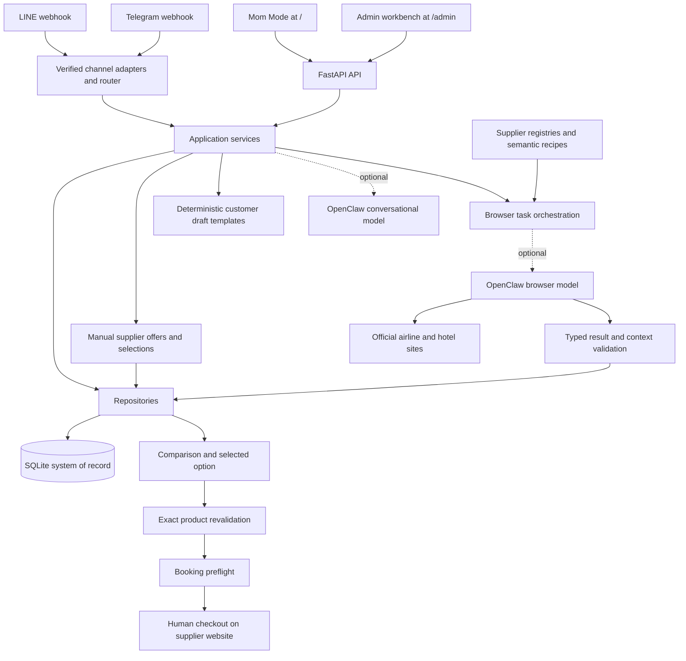

# Mom Travel Desk Developer Architecture

Updated: 2026-10-06. Application version: 0.8.1. Audience: engineers maintaining this repository.

Mom Travel Desk is a case-based internal travel-agency prototype. Its strongest implemented foundation is a shared case database with guided intake, typed official-site search workflows, deterministic comparison, and checks before human checkout. The web interface now supports intake, editable case requirements, manual supplier offers, comparison/selection, editable customer drafts, immutable quotes, business deadlines, verified booking records, a manual payment ledger, and pretrip summaries without OpenClaw. Official automation remains optional, and booking preflight stays in the admin/API workflow. This document describes the current implementation; proposed work and review findings are in [the current review](REVIEW_AND_DIRECTION_ZH_TW.md).

## Runtime and implementation map

The app is a Python 3.11+ FastAPI monolith served by Uvicorn. The reviewed environment uses Python 3.12 and the dependency versions in `constraints-tested.txt`. Both interfaces use plain HTML, CSS, and JavaScript; there is no frontend bundler or separate frontend service.



The external agents and live supplier sites were not connected during this review. The diagram shows the integration paths implemented in code, not evidence of a working live deployment.

| Location | Responsibility |
| --- | --- |
| [`app/main.py`](../app/main.py) | Lifespan, middleware, static mounts, API endpoints, webhooks, in-process background searches |
| [`app/config.py`](../app/config.py) | Frozen settings read from environment at import time |
| [`app/models.py`](../app/models.py) | Pydantic request, result, state, and preflight contracts |
| [`app/db.py`](../app/db.py) | Connection lifecycle, schema creation, additive migration markers, audit inserts |
| [`app/repositories.py`](../app/repositories.py) | SQL persistence for cases, sessions, runs, tasks, attempts, events, preferences, and feedback |
| `app/mom_static/` | Default operator UI: today, cases, new customer, intent helper, settings |
| `app/admin_static/` | Legacy workbench, comparison, revalidation, Browser Lab, site trust, approvals |
| `app/services/mom_ux.py`, `guided.py` | Rule-based next action, priority cards, keyword intent routing, six-step intake |
| `app/services/browser_tasks.py`, `browser_result.py` | Task planning/execution and strict output validation |
| `app/services/official_compare.py`, `hotel_compare.py` | Deterministic ranking of validated results, grouped by currency |
| `app/services/*revalidation.py`, `*booking_preflight.py` | Product matching, freshness, changed-condition acceptance, checkout blockers |
| `app/services/openclaw.py`, `replies.py` | Optional backend Gateway client; deterministic offer drafts and general draft fallback |
| `app/workflow_models.py`, `workflow_repository.py`, `services/case_workflow.py` | Manual offer validation/storage, original case context, selection snapshots, official result normalization, local drafts |
| `app/assistance_api.py`, `assistance_models.py`, `assistance_db.py`, `customer_repository.py`, `private_storage.py` | Private fulfilment/CRM/reminder contracts, additive schema, customer command receipts, shared backup encryption inventory |
| `app/services/traveller_services.py`, `crm.py`, `reminders.py`, `notification_worker.py`, `outbound.py` | Current traveller/booking bindings, customer communications, due-date policies, fenced outbox dispatch and SMTP/LINE transports |
| `app/channels/`, `app/services/channel_router.py` | LINE/Telegram verification, allowlists, event deduplication, shared chat routing |
| `app/services/pii.py`, `skill_feedback.py` | Optional encrypted vault; capture and redaction of feedback evidence |
| `app/airlines.py`, `app/hotels.py`, `recipes/` | Official-domain registries and semantic browser instructions |
| `openclaw/` | Intended agent configuration, workspace instructions, and 23 local Skills |
| `app/providers/mock.py`, `scripts/`, `tests/` | Clearly marked synthetic providers, audits, deterministic demos, regression suite |

## Data ownership and persistence

Mom Mode and the admin interface share the same database. A `TripCase` is the root record for a customer trip. Basic encrypted traveller records, versioned quotes and manual booking/payment records belong to each case; explicit customer profiles, encrypted communication history and per-traveller fulfilment now use separate linked records.

| Tables | Stored state and relationships |
| --- | --- |
| `trip_cases` | Customer display name, destination/origin, dates, adult/child/infant counts, optional child ages, budget, notes, status |
| `case_options`, `case_option_selections` | Immutable manual offer records and one selected snapshot per case and kind, with SQL foreign keys to cases |
| `guided_sessions` | Session key, draft answers/index, completion state, eventual case ID |
| `flight_search_runs`, `hotel_search_runs` | Request snapshot, task IDs, aggregate state, selected task/option IDs |
| `browser_tasks` | Supplier URL, instructions, expected schema, raw/typed output, review state, parent references |
| `browser_attempts` | Attempt number, source, timing, validation errors, blocker, result hash |
| `hotel_site_grants` | Exact independent-hotel host, attestation evidence, approval/revocation |
| `approvals` | Action type, summary, amount, decision and timestamps |
| `inbound_events` | Channel/event identity, payload hash, processing lease, saved response, delivery state |
| `user_preferences` | Shared default operator profile: airport, airlines, font size, onboarding |
| `skill_feedback` | Redacted draft/final/note, feedback outcome, local Skill hash, edit ratio, PII flag |
| `audit_log`, `pii_vault`, `schema_migrations` | Audit payloads, optional encrypted sensitive payloads, schema markers |

The logical relationship is case → search run → browser tasks → attempts/results; a selected option belongs to a task, and a revalidation task references its parent task/option. Most relationships are stored as IDs or JSON rather than declared SQL foreign keys. `PRAGMA foreign_keys=ON` alone does not enforce those logical relationships.

SQLite uses WAL, a five-second busy timeout, and a connection wrapper that closes connections after commit/rollback. Startup creates tables, adds selected missing columns, and records migration versions 701, 801, 802, 803, 804 and 805. Migration 802 adds infant/child-age fields and the manual option/selection tables, plus `browser_tasks.result_attempt_id` without dropping existing cases. This is an idempotent POC upgrade mechanism, not a general migration framework. Back up an existing database before first startup; consult [the migration guide](MIGRATION_V071_TO_V081.md).

## Request and workflow behavior

### Guided intake and next action

Intake asks for customer name, destination, departure, return, travelers, and total budget. Answers persist after each step. Dates use ISO format; travelers support shorthand such as `2大1小1嬰兒`. Starting again resumes unfinished intake but resets a completed session for the next customer. Completed shortcuts navigate to real workflows. Typed patches validate the merged record before writes under `BEGIN IMMEDIATE`, including nullability, date order and party composition. Completing intake creates a case and sets it to `quoting`. The session ID persists in browser local storage, whereas the answers live in SQLite.

Next Best Action is deterministic Python logic. It checks case status, missing information, search runs, and selected options. The intent helper uses keyword matching rather than a model. Today priority scoring considers all cases before choosing priority cards; closed cases are excluded. Only displayed cards calculate detailed next actions. Case-priority recommendations remain separate from the complete business-deadline list, which is loaded by the operations UI.

### Official-site search and validation

1. Create a flight or hotel request. A run stores the request snapshot and owns one or more tasks.
2. A browser task includes a supplier URL, semantic instructions, and a typed JSON contract.
3. The backend calls the dedicated OpenClaw browser model through `POST /v1/chat/completions` with a 120-second client timeout.
4. Parse and validate the returned contract, including supplier/domain and request context. Invalid output remains subject to review.
5. Store the attempt and result, then refresh the aggregate run state.
6. Compare validated options, select a specific task/option, and create exact-product revalidation.
7. Booking preflight verifies identity, freshness, rules/fees and explicit acceptance of relevant changes before returning readiness for human checkout.

Flight contracts are `flight-search-v1`, `flight-revalidation-v1`, and `booking-preflight-v1`; hotel equivalents are `hotel-search-v1`, `hotel-revalidation-v1`, and `hotel-booking-preflight-v1`. Registered airlines are CI, BR, CX, JX, AE, IT, EK, and NH. Built-in hotel networks are Marriott, Hilton, Hyatt, IHG, Accor, and Shangri-La. Independent hotel domains require a human-approved exact-host grant; known OTA/search domains cannot become official-hotel grants.

`completed` means processing reached a validated terminal state. It may include no results or a manual handoff; it does not imply that a usable option was found. Browser Lab distinguishes contract validity, usable results, and manual handoffs.

Mom Mode displays comparison candidates through the case workflow and lets the operator select an official option, updating the underlying run selection as well. Newly created case-linked searches capture the original case context server-side; changed needs or legacy runs without that context cannot supply an active offer. Revalidation and preflight remain in the admin/API workflow and are not replaced by selecting an option.

### Manual offers and selected snapshots

`POST /api/mom/cases/{case_id}/options` records an immutable operator-entered flight or hotel offer. It requires a positive two-decimal amount, currency, supplier/title, details and conditions, internal source reference, timezone-aware observation time and explicit attestation that the offer covers this case. Child ages must be known for family offers. The amount is a customer reference total, not a supplier-cost ledger. Source URLs may be ordinary HTTP(S) links and do not grant browser trust.

`GET /api/mom/cases/{case_id}/options` combines manual records with validated official comparisons. Result provenance is bound atomically to the exact `result_attempt_id`; legacy results without this evidence and Lab-ingested browser output are labeled demo and cannot be selected for an offer. `POST .../selection` persists one selected snapshot for each kind; `DELETE .../selection/{kind}` clears it. Snapshots are resolved against current evidence before drafting. Changed case needs, expired manual validity, stale official observations, changed content/other-interface selections, demos and missing results prevent offer drafting. All offers use explicit supplier expiry when present; otherwise `QUOTE_MAX_AGE_HOURS` defaults to 24 hours. This quotation window is independent of the stricter 20-minute checkout revalidation policy.

Selections and manual offers persist across browser/server restarts. The manual agency lifecycle below adds versioned quotes, optional private supplier costs, browser print-to-PDF, and human-verified booking records. Capturing/validating an offer does not confirm inventory or execute checkout.

### Background execution

Mom start endpoints schedule FastAPI `BackgroundTasks` and save `running` state. Tasks inside a run execute sequentially. Closing the browser view is safe while the server remains running; process restart does not automatically recover in-flight work. There is no durable queue, worker lease, startup recovery, or transactional claim around the start operation. The check/set sequence also leaves a possible duplicate-start race; concurrent execution was not tested in this review.

A durable job layer is proposed for the pilot, with idempotent claims, worker heartbeats, bounded retries and recovery. FastAPI describes background tasks as work performed after the response and discusses separate queue-backed tools for larger workloads. The durability requirement here follows from this repository's implementation. [FastAPI documentation](https://fastapi.tiangolo.com/tutorial/background-tasks/)

### Drafts and feedback

Customer-reply drafting works without OpenClaw. With selected offers, deterministic templates use structured details, Decimal arithmetic, official-site URLs and Taipei timestamps. Manual supplier names, source references/URLs and raw parser warnings stay out of customer drafts; operator-entered titles/details/conditions must be customer-visible. Mixed currencies are never summed. Invalid selections suppress offer amounts and produce a needs-confirmation reply instead. General drafting may use the optional conversational model; disabled, failed or empty model responses fall back to a local customer-facing template. Local templates are bounded and do not fully interpret arbitrary customer questions.

The UI exposes an editable textarea and copies its current contents, reporting clipboard failure accurately. It collects accepted, edited, prefer-future and rejected feedback. The service applies pattern-based redaction, optionally replaces the bound case name, attributes the record to the SHA-256 of the local Skill, and stores evidence. It does not update live Skills or immediately personalize the next reply. The local file hash does not prove that a separately installed Gateway Skill matches that file. Template feedback is labeled `web_template` and has no OpenClaw Skill hash.

### Channels

LINE verifies the raw-body HMAC signature and operator user allowlist. Telegram verifies its webhook secret and chat allowlist. SQLite event claims support deduplication, collision detection and replay of a saved response after failed delivery. This is not a complete transactional outbox or an exactly-once guarantee across case creation, response storage, and external delivery.

The current router supports menu/intake/radar/case listing. Flight entry redirects to the web interface; hotel entry still uses outdated text saying it is in a future phase. These adapters are groundwork for an internal operator channel, not a complete customer-facing LINE workflow. The handlers await drafting and outbound delivery within webhook handling; an asynchronous ingestion/outbox design is proposed. [LINE webhook guidance](https://developers.line.biz/en/docs/messaging-api/receiving-messages/)

## Security boundaries and limits

Regulatory/document claims in the optional agent Skills follow [official-source verification](../openclaw/skills/visa-check/references/official-sources.md): fresh reads, applicable-date/version matching, provenance and unresolved conditions. The registry is a maintenance snapshot; there is no runtime regulatory provider, freshness enforcement, background monitoring or implemented visa-eligibility workflow. Copying the complete skill tree preserves shared reference links; deployment must separately install these instructions.

- `/api/*` requires a shared operator token when configured; production startup rejects a missing token. Development without a token is open to clients that can reach the server. In shared token mode there is no per-user identity or role separation. Cloudflare mode supports verified operator/admin identities; neither mode implements per-customer ownership permissions.
- Mom Mode stores the operator token in session storage. Gateway/channel credentials remain on the backend. `/admin` is interface separation, not an authorization role.
- Mom Mode has a strict CSP; the legacy admin interface permits inline scripts/styles. API responses have `Cache-Control: no-store`. The manifest is a shell without an offline service worker.
- The middleware checks declared `Content-Length`; it does not count streamed body bytes. Enforce body limits at the ingress as well before exposure beyond a local preview.
- Domain/result validation and preflight checks run in application code. Browser/tool permission isolation and stopping before irreversible supplier actions also depend on the deployed OpenClaw configuration. That host configuration was not inspected or verified.
- Payment handling is blocked. Approval records do not automatically issue tickets, book, cancel or refund. CAPTCHA, login, OTP, 3DS and final checkout require a human.
- The Fernet vault is optional and refuses sensitive storage without a key. It does not encrypt ordinary case fields, audit payloads, raw task outputs or all free-text input. Feedback redaction is pattern-based and does not guarantee complete anonymization.
- Typed case patches now reject invalid/unknown fields and validate merged state before persistence. Previously corrupted rows are not automatically repaired by migration; this update prevents new invalid writes.

## Local setup and service management

Run from the repository root. Use a new database for exploration; do not point the preview at an existing operational database.

```bash
python3 -m venv .venv
source .venv/bin/activate
pip install -e '.[dev]' -c constraints-tested.txt
cp .env.example .env
uvicorn app.main:app --host 127.0.0.1 --port 8001 --env-file .env
```

Only copy `.env.example` if `.env` does not already exist. For this review, `.env` uses `TRAVEL_DESK_DB=./data/local-review.db` and `PUBLIC_BASE_URL=http://127.0.0.1:8001`. `--env-file .env` is necessary because `config.py` reads the process environment without loading dotenv itself. Restart the server after changing configuration.

| Current review resource | Location |
| --- | --- |
| Operator UI | <http://127.0.0.1:8001/> |
| Admin workbench | <http://127.0.0.1:8001/admin> |
| Liveness and configuration diagnostics | `/health`, `/api/system/readiness` |
| API schema | `/openapi.json`; `/docs` may have its external assets blocked by the current CSP |
| Local data and process files | `data/local-review.db`, `data/local-server.log`, `data/local-server.pid` |
| Current browser workflow evidence | `data/web-workflow-browser-report.json`, `data/verify_web_workflow.py`, `data/workflow-options-desktop.png`, `data/workflow-options-mobile.png`, `data/workflow-draft-desktop.png` |

The review server was launched detached. To stop it, inspect the PID recorded in `data/local-server.pid` with `ps -p <PID> -o command=`, confirm it is this checkout's port-8001 Uvicorn process, then `kill <PID>`. Run the foreground command above to restart it. Port 8000 already belongs to a different checkout and was left running.

The packaging blocker found during setup was fixed by declaring the setuptools backend, limiting package discovery to `app*`, and including both static directories as package data. Installation now succeeds. The application still resolves `recipes/` and `openclaw/` relative to the source root: source checkout/container deployment remains the supported layout, and wheel-only deployment with all runtime assets has not been validated.

Docker Compose binds port 8000 to loopback, uses a named data volume and a non-root/read-only container setup. The Docker image was not built in this review. It currently installs without `constraints-tested.txt`, so its resolved dependencies may differ from the reviewed local environment.

Use `scripts/database_backup.py backup SOURCE NEW_TARGET` for a consistent validated snapshot and `restore SNAPSHOT NEW_TARGET` for recovery. For complete recovery use encrypted database/original-file bundles via `scripts.backup_bundle`; the local per-user six-hour schedule is installed and verified. The database-only script remains a plaintext diagnostic snapshot. See [the backup and recovery runbook](BACKUP_AND_RECOVERY.md). [SQLite backup documentation](https://www.sqlite.org/backup.html)

## Verification and engineering priorities

Executed on 2026-10-03:

| Check | Result |
| --- | --- |
| Editable installation using tested constraints | Passed after packaging fix |
| Wheel build, package scope and static assets | Passed; live wheel-only deployment not validated |
| Current pytest suite | 136 passed on Python 3.12 and 3.11.14, including guide generation and Access static-asset checks |
| Python compilation and both JavaScript syntax checks | Passed |
| Local Skill audit | 23 Skills passed |
| Airline recipe audit | 8 recipes and 16 regression cases passed |
| Hotel recipe audit | 1 recipe and 4 regression cases passed |
| API smoke and deterministic flight/hotel demos | Passed; synthetic data only |
| Headless Chrome at desktop and 390 px mobile width | Three consecutive customers, prefills including infant, manual offers, selection, draft editing/copying and reload persistence passed |
| Invalid case patches | Rejected with HTTP 422; original record and case listing remain intact |

The historical 80% coverage figure belongs to the earlier report; coverage was not remeasured here. Live supplier reliability, real AI drafting, payment handoff, real channel delivery, server-crash recovery, and production deployment remain unverified.

This increment completes case validation, intake lifecycle, prefills/party preservation, result selection and customer drafts. Next add versioned quotes, explicit work deadlines, verified booking confirmations, reliable jobs, and a user-facing revalidation/preflight flow before expanding booking support. Extend the existing system of record rather than adding a second UI database. See [the prioritized direction and acceptance criteria](REVIEW_AND_DIRECTION_ZH_TW.md).

Legacy cases are read without newly introduced cross-field constraints so inconsistent historical dates do not break listing or home. Creates and merged patches enforce those constraints before SQL writes; operators can repair historical cases using the edit form. Concurrent final intake requests and atomic cross-table official/Mom selection writes remain follow-up hardening work.

Read-only external verification: Claude Code was chosen for high complexity (UI/API/schema/services, >150 changed non-test lines); final verdict APPROVE after three rounds. No unresolved blockers/majors. Remaining minor cleanup and concurrency hardening are recorded in the current review. Usage gate was unknown (`no usage snapshot`), so review proceeded under the supplied policy.

## UI refinement and public tunnel authentication increment

Visible versions are removed from Mom and admin UIs and retained in HTML comments and engineering metadata. Mom Mode uses warm paper surfaces, a navy hero, terracotta accents and code-native SVG icons. A 200px desktop sidebar becomes bottom navigation at 900px; 901–1200px uses two shortcut columns and a stacked workspace, while larger desktop screens use four shortcuts and two workspace columns. The general workflow rail is explicitly descriptive, not live booking progress. Priority cases have visible sequence numbers and list semantics. Compact case rows and collapsed search history preserve large text and touch controls. Navigation synchronizes aria-current and focuses the destination heading; background refresh does not move focus.

Optional `AUTH_MODE=cloudflare` validates Access RS256 JWTs in `app/cloudflare_access.py` using a fixed issuer/audience and bounded asynchronous JWKS cache; `app/security.py` owns exact exemptions, operator route allowlists, admin defaults and origin checks. All paths are protected except minimal `GET /livez` and exact signed-channel webhook POSTs. `/api/auth/session` supplies mode and safe identity metadata for web login/logout UI. Token mode remains a local/private compatibility path. Production disables interactive API docs and OpenAPI. Docker healthcheck uses `/livez`; detailed `/health` remains authenticated in Access mode. Accounts share this agency's cases; no multi-tenant isolation is claimed. See [deployment verification and limits](CLOUDFLARE_ACCESS_DEPLOYMENT.md).


Both frontends discover `/api/auth/session` before reading legacy credentials. Access mode clears both legacy sessionStorage keys and uses browser-managed Access cookies; no JWT is stored by UI code. Expired sessions or manual opaque redirects show a named, non-dismissible login dialog. A dedicated reauthentication error prevents error handlers from replacing case lists, drafts or form contents; Mom opens login in another tab and resumes the original form without reload; the admin login button still reloads. Ordinary failures still render their normal error states. Admin inline async handlers suppress only already-handled reauthentication rejections.

UI validation: 16 headless Chrome checks passed, including 390px large/extra-large fonts, 768/1024px extra-large fonts, desktop layout, version hiding, empty/error states, role visibility, credential clearing, expired-session data preservation, opaque redirects and Escape-key persistence. The full three-customer/manual-offer/selection/draft-copy/reload regression also passed. See [design QA](../design/qa.md). Real Access deployment, live supplier sessions and a manual screen-reader audit remain unverified.


## In-web user guide and workflow coverage

`/static/guide.html` is generated from `docs/USER_GUIDE_ZH_TW_DRAFT.md` and `scripts/templates/user_guide.html` by `scripts/build_user_guide.py`. Only the development extra requires markdown-it-py; served deployments use checked-in HTML/CSS/JS and never parse Markdown at runtime. The generator disables source HTML, supports tables, assigns stable app-linked chapter fragments, and offers a non-writing byte comparison via `--check`. Tests catch drift and unresolved fragments. Regenerate after editing the source or template.

Mom Mode links to the guide from the topbar, settings and the shared sheet header. Chapter metadata is passed to `openSheet`, keeping links out of form markup. Every help link opens a separate tab with noopener, so help does not replace an unsaved form. The guide's workbench link opens a fresh app tab; users must return to their original tab to continue unsaved work. Guide font size is stored locally and printing hides controls/navigation while retaining all chapters. Content and anchor navigation remain usable without JavaScript.

Cloudflare mode protects guide HTML/CSS/JS with the existing operator rules and strict CSP. Token/local mode exposes static guide assets to anyone able to reach the server, like the existing app shell; the guide contains instructions, not customer records or credentials. No auth exceptions or backend routes were added.

The [coverage check](WORKFLOW_COVERAGE_ZH_TW.md) distinguishes usable Mom workflows, optional but unverified automation, admin/API-only checks, and remaining specialist-product gaps. Intake through manual booking/payment records and pretrip handoff are supported. Booking status labels, policy enums and preflight contracts do not establish completed reservations, payments, issued tickets or delivered pretrip documents.

## Manual agency lifecycle (schema 803)

`operations_models.py` validates commands, Decimal money, aware timestamps, explicit human attestation and HTTPS customer links. `operations_repository.py` stores case-scoped JSON records in `agency_quotes`, `agency_work_items`, `agency_bookings`, `agency_documents`, `agency_ledger`, and `agency_pretrip`. `agency_commands` retains retry results. Migration 803 is additive and idempotent, preserving schema 802 cases, selections and options. Back up the SQLite file with its backup API before upgrading; the upgrade has no down-migration.

Every write uses one `BEGIN IMMEDIATE` transaction for validation, the mutation, the saved command response and its audit record. Audit includes actor, record ID, reason and before/after case status. The UUID is case-scoped; its hash includes action, verified actor and normalized Pydantic payload. Identical retries return the original response, different content returns 409, and failed writes roll back the command key. Lock contention becomes 503 so the client can retry the same intent. Financial values remain exact two-place Decimal strings; currencies never implicitly convert, missing costs/unmatched quote currencies remain unknown.

Quote creation performs expensive option/provenance checks outside the write lock, then compares before/after/current trip and selection/source guards inside the transaction. Versions and monetary/customer content are immutable; only decision state and evidence events change. One accepted quote per case is enforced by a partial unique index. An explicit accepted-quote amendment requires reason/attestation, replaces other active versions, preserves case-level payment history and marks old booking bindings for reverification. Display-name spelling changes do not invalidate travel constraints. Generic case PATCH cannot newly set booking/confirmed; those states follow quote acceptance and verified kind coverage.

Booking references are case-scoped and normalized for case/whitespace when checking duplicates. Same references in other cases show an internal warning, allowing legitimate group bookings. Rebinding a valid confirmation to a newly accepted quote requires a new supplier check, reason and customer-facing details; it retains prior bindings/details/evidence in history. Voiding a mistyped record is local bookkeeping, never a supplier cancellation. Document revisions can correct booking bindings or required flags with reason/attestation, preserving history. Required electronic tickets and hotel vouchers, current booking coverage and document readiness gate delivery.

Pretrip versions snapshot the trip, accepted quote, all booking records and document revisions. Any change makes an old pack stale; the API rechecks export and delivery in a consistent read/write transaction respectively. Stale exports return 409; stored source and delivery history remain available internally. Draft packs show blockers and cannot be exported or marked delivered. Public HTML exports whitelist customer fields and escape all strings; they exclude supplier windows, internal evidence, costs and ledger records. No URL is fetched and original attachments are not merged into public output; schema 805 stores them separately in the encrypted private file workflow. No message or financial/supplier transaction is executed.

The web extension `mom_static/operations.js` registers actions/forms/views with `MomApp` rather than exposing mutable app state. Dialog request generations prevent old responses from replacing newer screens. Each form retains its UUID while an outcome is uncertain and rotates on changed content or definitive 4xx. Reauthentication uses a separate login tab and resumes the original form. For local token-mode print, the browser opens a blank popup, detaches its opener, fetches customer HTML through the authenticated helper and resolves only app asset URLs; secrets never appear in document URLs or DOM. Public copy and print share the server's same export boundary. No browser persistence is added for private operational form contents.

API groups (all under the existing origin, role and JWT middleware):

| Endpoint | Purpose |
| --- | --- |
| `GET /api/mom/work-items` | All cases/statuses with business timezone, no four-case cap; UI filters open/done/cancelled |
| `GET /api/mom/cases/{case_id}/operations` | Case-scoped records, currency balances, blockers/stale flags |
| `POST .../quotes`, `POST .../quotes/{id}/{sent,accept,reject}` | Immutable quote and explicit manual decision evidence |
| `POST .../work-items`, `PATCH .../work-items/{id}` | Responsibility, due time, source and optimistic revision/reason |
| `POST .../bookings`, `POST .../bookings/{id}/{void,rebind}` | Supplier-verified confirmations and corrections |
| `POST .../ledger`, `POST .../ledger/{id}/void` | Actual manual receipts/payments/refunds and corrections |
| `POST .../documents`, `PATCH .../documents/{id}` | Checklist, public text/link, requirement/binding repair |
| `POST .../pretrip`, `POST .../pretrip/{id}/deliver` | Versioned summary and explicit actual handoff evidence |
| `GET .../{quotes,pretrip}/{id}/document` | Authenticated customer-safe HTML print/copy |

Operator permissions use exact path/method allowlists; unknown suffixes/actions default to admin protection. The current Access model is a shared agency workspace, not per-customer or tenant isolation. Real Cloudflare tunnel, IdP/MFA, live supplier transactions and Mom's workload coverage still require separate deployment/user validation.


## Reliability hardening (2026-10-03)

Ready documents now store a human verification stamp: canonical travel context, effective booking ID, booking revision and its accepted quote ID. Each current flight/hotel booking requires its own required, ready electronic ticket/hotel voucher. The server validates the effective merged binding, including an omitted booking ID, and rejects mismatched product kinds. Unbound non-product documents depend on travel context rather than fee-only quote amendments. Display-name edits leave verification current; changing dates, destination or travellers invalidates it. Booking reverification changes its revision, requiring a separate document check even when the booking ID is unchanged. No verification is invented for legacy records; response-only `needs_recheck` marks old ready documents for an explicit human PATCH. Checklist items may remain missing/unbound, allowing repair of old associations.

Public output excludes documents without current verification. Export and delivery re-evaluate blockers; a legacy prepared pack with an unchanged hash cannot bypass the new rules. The existing conservative policy remains: obsolete prepared **and delivered** packs return 409 on customer export. Historical source and actual delivery evidence remain internally stored. Recheck the documents and generate a new version before re-output; a separately labelled historical audit export remains future scope. No schema migration or automatic evidence backfill is needed.

Case PATCH compares the validated before/after travel context. A real travel edit resets booking/confirmed to quoting, including when the form resends the old status. Identical field values and display-only edits do not reset status. An explicit travelling transition remains an operator decision; reverting travel fields does not silently re-confirm the case. Case update and its verified-actor audit share the same transaction. Generic status bypass retains its existing 422 API contract. Generic PATCH cannot close a case, reopen it or modify a closed case. The explicit lifecycle endpoints described below retain the existing 422 contract for generic bypass attempts.

Home and case primary actions share the same backend lifecycle decision: urgent open deadline, changed/expired quote, draft/sent quote, missing adopted booking, document blockers, prepared summary awaiting actual handoff, then current delivery history. Outstanding balance alone does not prescribe a payment entry. Home prioritizes overdue/today open tasks; business dates use Asia/Taipei.

Authentication runs before `RequestBodyLimitMiddleware`, which counts actual ASGI request bytes, including requests without Content-Length. It buffers only within the configured limit before dispatching routes, preserves exact raw webhook bytes, and rejects oversized requests with 413. Invalid/negative or duplicated Content-Length yields 400. The outer security middleware adds headers to these errors. Installed Starlette 0.50.0 lacks a native body limiter, so this small stateless ASGI wrapper follows the [official HTTP receive contract](https://asgi.readthedocs.io/en/latest/specs/www.html#request-receive-event). Private token comparison uses UTF-8 bytes so non-ASCII invalid headers return 401, not 500.

The root `.dockerignore` excludes secrets, data/backups, database sidecars, virtual environments, VCS and test evidence before sending the build context; runtime recipes and application/static assets remain included. This follows [Docker's build-context documentation](https://docs.docker.com/build/concepts/context/#dockerignore-files). Git ignore patterns alone do not control image contents.

The web UI protects dirty forms and newly generated/edited replies. Cancel keeps the same DOM; confirming departure explicitly discards unsaved content. There is no browser-storage draft copy. In-flight saves block leaving until the outcome is shown; committed writes permit their own navigation and cannot be resubmitted. Async transitions carry a generation token; new edits during loading trigger another legitimate guard. Native queued close events cannot cancel a newer request. Independent loaders let catalogue/preferences failures degrade locally while cases/home/deadlines continue; component retries and latest-response guards preserve usable prior content. Authentication failures still open the existing login flow. Deadline templates fill only title/kind; the actual deadline, owner and source remain required human input.

Run `scripts/verify_mom_workspace.py --chrome /path/to/chrome` with Playwright for disposable-database browser regressions; this script never connects to the port-8001 preview. Screenshots use synthetic customers only.

Two minor inherited limits remain outside this surgical change: a blank string and null origin are different canonical model values and can trigger reverification; disconnecting during upload can produce outer Starlette middleware log noise while the bounded reader stops before route side effects. Neither creates an automatic transaction or guessed verification. Broader normalization and disconnect logging can be addressed separately.


## Explicit business closure (schema 804)

`POST /api/mom/cases/{id}/lifecycle/close` and `/reopen` use separate Pydantic commands, human evidence, a UUID retry key and a SHA-256 `expected_state`. The fingerprint covers the persisted case, agency records, offers/selections and case-associated search/task rows, before adding response-only flags. The read summary and the write transaction use the same eligibility and reopening derivation. `BEGIN IMMEDIATE` serializes the command, lifecycle event, quote withdrawal, case status, UUID response and verified-actor audit.

Completed closure requires an adopted matching quote, booking coverage, verified product documents, a current delivered pack, no open work and customer balances exactly zero per currency; unmatched nonzero customer receipts block closure. Supplier settlement and remaining services require explicit human attestation because the internal ledger cannot infer the supplier's final invoice. This is business completion, not evidence of a completed trip.

Withdrawn closure requires no open work, confirmed bookings or net customer/supplier amounts. An adopted quote additionally requires explicit `withdraw_adoption_checked`; it becomes `withdrawn` in the same transaction, preserving its original acceptance events and closure evidence. Reopening cannot revive that adoption. Dedicated change/cancellation/refund/incident orders now record manual supplier execution and fee evidence; fee rules remain manually verified.

Reopening derives confirmed/booking from a matching adopted quote and current booking kind coverage, quoting for a stale adoption or prior offers/quotes, intake otherwise. It never infers travelling. Existing closed cases without lifecycle events can reopen after human checking. `agency_case_events` uses plain INSERT, a case index and SQL triggers rejecting updates/deletes. Existing data is not backfilled with invented evidence.

Common agency commands reject closed-case mutations after checking successful UUID replay. Case edits, offers/selections, search creation, run mutation and browser-task creation/update recheck case status under the write lock. Only running searches or running/dispatched tasks block closure. Saved planned/queued work remains inert after closure; its later start is refused. Late diagnostic attempt/audit records may still be retained; they cannot alter closed case business records. Operator authorization admits only the exact two POST lifecycle paths and continues to require verified JWT identity and the configured Origin.

The Mom interface keeps five primary work modules and a compact lifecycle entry. Closed modules retain history and customer exports while removing mutation controls; reopen is prominent. Explicit quote withdrawal is disclosed before the required checkbox. Operation forms reuse dirty-edit protection, generation ownership, read-only committed state and UUID retry semantics.

Local reproducible verification now includes hardened Docker restart and recovery, and Chromium/Firefox/WebKit browser engines. WebKit automation is not physical iPhone or Safari user acceptance. Technical references checked on 2026-10-03: [Python SQLite backup](https://docs.python.org/3/library/sqlite3.html#sqlite3.Connection.backup), [Docker runtime flags](https://docs.docker.com/reference/cli/docker/container/run/), [Playwright browsers](https://playwright.dev/python/docs/browsers). No travel-law content changed in this increment.


A stuck running search, or a running revalidation under a completed/partial run, has an admin-only evidence operation: `POST /api/browser/runs/{id}/abandon` (flight) or `/api/browser/hotel-runs/{id}/abandon` (hotel). BackgroundTasks execute inside the FastAPI process: first wait for the in-flight OpenClaw call to end or restart the application, then verify it stopped. An administrator must do this before abandoning work, then submit `expected_updated_at` from the current run, reason/reference/occurred_at, `checked=true`, `worker_stopped_checked=true` and a request UUID. The locked command changes that run and pending tasks to failed and writes evidence/audit/retry results atomically. It does not claim to cancel a running remote browser or supplier operation. It is an administrative API, without a new Mom action or automatic timeout; other failures retain normal human review.

Standalone case-associated running tasks use `POST /api/browser/tasks/{id}/abandon`, with the same current `expected_updated_at`, identity, evidence and explicit stop attestation. Linked tasks must be abandoned through their parent run. Both operations have stale-state, required-attestation and idempotent-replay regression tests. Never mark an actually executing call stopped: late callbacks on an open case remain possible. Closed cases reject the business writer regardless.


## Private traveller and original-file workflow (schema 805)

`travel_files.py` owns encrypted traveller payloads, immutable encrypted originals, roster verification and audited reveal/download. Tables `agency_travellers`, `agency_rosters`, `agency_attachments` reuse the operations repository. Traveller mutations and upload commands return IDs/revisions/status only: neither cached command responses nor audit records contain the supplied passport payload. Sensitive command fingerprints use keyed HMAC. Roster hashes cover IDs/revisions/status and trip constraints, never plaintext PII. Summary GET exposes ordinal/category only; explicit authenticated reveal is audited and allowed to agency operators. Cloudflare users share the agency's case scope; this is not a per-customer ACL system. Token mode attributes everyone to `operator`.

Uploads are raw authenticated binary POSTs on the exact document attachment route. Middleware bounds actual bytes at 10 MiB for this route; other APIs retain their configured 1 MB limit. PDF/JPEG/PNG extensions, MIME and signatures must agree. Original names travel in a header, are encrypted, and are never storage paths or download names. Random immutable blobs live outside static assets with 0700/0600 permissions. Downloads use attachment disposition, no-store, nosniff and CSP sandbox. There is no antivirus or CDR service. File count/bytes include archived history (100 / 200 MiB per case), plus a free-space reserve. Replays are checked before writing under the existing SQLite transaction; post-write DB failures may leave an orphan, reported after 24 hours without automatic deletion.

A roster is optional for legacy cases. Once used, category counts must match the case and a human verification must cover the current trip and every traveller revision. Roster changes invalidate document proof and pretrip output. Upload/archive invalidates the linked document and pretrip output; a document that has used originals requires at least one active original to become ready. Traveller edits replace the current encrypted payload; previous plaintext/ciphertext field values are not retained as traveller history, while revisions and audit actions remain. Closed cases permit audited reads/downloads but reject all writes. Public quote/pretrip exports never include traveller payloads or original blobs. Schema migration adds tables; older pretrip source hashes may become stale and require a newly checked summary.

`travel-files.js` uses the shared sheet/generation/auth/save helpers. Full fields are fetched after explicit reveal/edit only and cleared on close/auth expiry. Upload retry receipts in sessionStorage contain case/document IDs and UUIDs only. Network/auth uncertainty reconciles the receipt before retransmission; reload requires reselection when no commit is found. Browser files and plaintext private values are never persisted in web storage.

Reminders and atomic handovers reuse work-item revisions/history. Acknowledgement increments revision but does not complete the task; any later patch clears it. Handover validates every selected open task before updating owners in one command transaction. Taipei buckets are overdue, today, next seven days excluding today, and later; names are whitespace-normalized for grouping. Change/refund/incident templates use existing task kinds and manual evidence, without executing supplier transactions or sending messages.

Encrypted backup bundles are maintained by `python -m scripts.backup_bundle`, outside HTTP workers. Admin exposes observed status only. `fcntl.flock` serializes snapshot/copy/publish/retention. A SQLite online snapshot, authenticated encrypted inventory and verified immutable blobs form each bundle. The whole DB is encrypted with Fernet, bounded to 128 MiB; oversized DBs require a future chunked backup format. Retention only removes this tool's authenticated bundles, preserving the newest; failures preserve the last success. Offline restore refuses existing DB/files targets and sidecars. Keep the historical key outside backups: rotation needs an explicit decrypt/re-encrypt migration; merely changing the key is refused by key-ID checks. See the backup runbook for scheduling, recovery and remaining operational limits.

Encryption scope: traveller payloads, original bytes/names and backup bundles are encrypted. Legacy case names/notes, booking descriptions, task/evidence text and normal audit reasons remain plaintext in the live database. Do not put passport/payment credentials into those fields. Encryption keys remain environment configuration; this is not a secret-manager integration or full database-at-rest encryption.

Security design checked against the [OWASP upload guidance](https://cheatsheetseries.owasp.org/cheatsheets/File_Upload_Cheat_Sheet.html), [Fernet documentation](https://cryptography.io/en/latest/fernet/), [SQLite backup API](https://docs.python.org/3/library/sqlite3.html#sqlite3.Connection.backup), and [Docker build guidance](https://docs.docker.com/build/building/best-practices/) on 2026-10-05. No new travel-law or visa eligibility logic is introduced.

## Manual service orders (schema 806)

`service_order_models.py` defines evidence-bearing commands and a discriminated `progress` union; `services/service_orders.py` owns change, cancellation, refund and in-trip incident workflows. `agency_service_orders` stores current JSON plus indexed status/due/owner responsibility in the payload; due/status/case form the deadline index. Existing `command()` serializes revision checks, ledger writes, supplier booking updates, order history, replay receipts and audit in one SQLite transaction. Exact method/path authorization follows the existing operator allowlist; unknown suffixes remain denied. Closed-case writes use the central command guard.

A normal order captures request/targets/owner/due, supplier terms and source/expiry, customer approval of a specific assessment, manual execution evidence, supplier result, four-direction actual cash and notified resolution. Immediate incident assistance can be recorded and resolved without a quote or monetary approval; monetary work then requires a fresh assessment and approval. Supplier refusal is a recorded terminal outcome after corrective cash/approval checks. Reassessment/reopening clears monetary approval and execution authorization while preserving irreversible supplier facts and actual ledger entries. Wrong supplier evidence is corrected by appended notes; a subsequent provider action requires a new order. A checked append-only `rebind_result` updates effective booking revisions while preserving the original supplier result and earlier binding history. Pure cash/source rules live in `service_order_state.py`, without a service dependency.

Assessment money uses decimal strings and separate currencies. `final_customer_due` is the **whole case's final amount owed**, already including fees, not an incremental change charge. Four cash totals are for this order only; informational supplier/agency fee fields are not added again. Actual entries reuse `agency_ledger` with `service_order_id` and an optional accepted quote. Resolve requires exact approved-versus-actual totals over the union of currencies; installments are capped at the remaining amount and refunds also obey case receipt/payment caps. General refund entry is rejected for currencies covered by an active assessed order. Voiding a linked entry increments order revision/history and invalidates financial resolution. Balances show both the immutable quote total and the latest financially valid resolved total associated with the current accepted quote; a newly accepted quote does not inherit an older adjustment. Supersession is per assessed currency: each currency’s latest resolved money assessment must retain the current quote binding. A JPY-only order cannot supersede a TWD assessment. The shared latest-assessment map includes resolved orders whose cash was later voided; an invalid latest assessment blocks closure and never revives an older final due. Older settled orders remain cash history. After cancellation withdrawal, the latest adjustment may retain the ended trip’s quote binding, preserving later refunds across case reopen. Withdrawal at case closure keeps cash resolution valid; closed cases emit no service deadlines.

Full cancellation requires no confirmed bookings, explicit end-trip resolution and final cash reconciliation before `CaseClose.outcome=cancelled`; supplier settlement and withdrawal of accepted quote are manually attested. Supplier cancellation updates a confirmed case to reflect lost booking coverage, while the next action still points to its active service order and then cancellation closure. Manually selected travelling or intake progress remains intact. Service-only incident cases can close without a fictional travel quote or pack. Existing completed/withdrawn guards remain in place.

Pending change/cancellation signatures appear in pretrip source **only when blocking**, preserving schema-805 hashes when no order exists. Actual cancellation voids booking records with a distinct supplier-cancelled fact. Confirmed change results bind current booking revisions and the adopted quote. Blocking clears once provider result bindings are current, allowing rechecked documents/new pack delivery before resolving the order. If a pack was previously delivered, change completion requires a current delivered replacement.

`service-orders.js` reuses the existing tasks entry and single sheet. Revision conflict preserves inputs and shows current conditions; consequential retries lock on changed assessment/booking bindings. Session storage persists case-keyed order/action/UUID and verified actor metadata only; uncertain writes and reloads reconcile server receipts before retrying. Actor-scoped mutation selection preserves other actors’ pending metadata. Read-only recovery probes all retained UUIDs; only an owner-authorized committed receipt removes one, which repairs historical incorrectly tagged intents without replaying foreign writes. Only actor-less legacy conflicts receive a local ownership marker. The frontend rechecks its captured actor after receipt awaits and before/after mutation. Each service mutation and receipt GET optionally binds `X-Travel-Service-Actor` (URI-encoded, normalized) to the request’s verified actor through `service_actor`; mismatch returns 412 and preserves the retry intent. Omission remains compatible with older API clients and grants no extra permissions. Every mutation 4xx except identity 412 is receipt-reconciled before discard: committed navigates to saved content, confirmed uncommitted permits a correction, and unavailable/foreign receipts keep the UUID and frozen body. This applies to create as well as money and existing-order actions. Confirmed change results and result rebinding submit exact selected booking revisions captured when the form opened; cancellation submits all original target IDs with the displayed revisions. The backend checks keysets and revisions transactionally. Old clients without the map fail closed (409 on a confirmed change result, 422 on result rebinding); pending retries must retain their original payload and UUID. Contact drafts/displays clear on authentication expiry. The already-submitted body remains immutable in memory until confirmation or leaving the form, including its contact value; it is never serialized into session storage. These ordinary service fields, including contact/evidence, remain plaintext in the live database like existing case notes; use the encrypted roster for passports, and never enter payment credentials here. Schema 806 is additive and encrypted backup validation accepts 803–806. Repeatable browser evidence is produced by `scripts/verify_service_orders.py`.


## Private assistance data and reminder dispatch

Schema 807 is additive. `TripCase` owns trip business records; customer profiles are independent and explicitly linked to cases by one primary link. Display names remain plaintext for bounded name search, matching existing case-name behaviour. Phone, email, notes, ticket numbers, segments, special requests and communication bodies are encrypted with the configured Fernet key. This is field encryption, not encryption of the live SQLite file. Summaries, audit events and command receipts contain operational metadata; users must keep identity numbers out of evidence references and ordinary case fields.

`agency_traveller_services` references an existing traveller and booking. It captures their revisions and the current adopted quote/trip binding. Seat, meal, wheelchair, baggage and other requests have independent request/confirmation states. Identity-roster fingerprints do not include fulfilment edits. Pack sources include a service metadata key only when records exist, preserving prior unused-service hashes. Stale active service bindings block delivery and change-order resolution until rechecked or archived. Operations exports exclude private service payloads.

`agency_customers` is canonical for contacts and email consent. `agency_customer_links` has one row per case; corrections preserve link history. Communications keep the original customer ID even after a link correction. Draft body edits preserve encrypted prior bodies; complaint owner/status changes preserve only their changed operational history, rather than copying the same ciphertext. Saving or copying a draft never marks it sent. An explicit attestation records actual manual sending. Narrow `crm.*` commands may append communication/profile-link data after closure, without modifying business tables. Global customer commands have independent UUID receipts, namespaced UUID5 creation IDs, optimistic revisions and private HMAC fingerprints.

The independent worker is the sole creator of notification jobs. Policies reference actual work-item/service-order due dates. Customer recipients use the explicit primary link plus current email consent/profile revisions; email changes revoke prior consent. Staff email/LINE recipients must be configured allowlisted accounts. Customer LINE requires a future secure binding workflow. OpenClaw is optional and receives no automatic private CRM history.

The outbox stores indexed lease, status, retry and occurrence metadata plus one encrypted snapshot of the exact destination/body. The snapshot is immutable. An accepted customer notification's CRM entry references that snapshot by a unique foreign key, so the body is stored once and remains available after policy edits. Minimal origin routing metadata is captured with the snapshot so an in-flight policy change cannot misattribute the completed communication.

Claims recheck source, closure, policy, ownership, consent, profile, epoch and channel flags inside a short SQLite transaction. Network calls hold no SQLite connection. Lease tokens fence results; expired SMTP leases become unknown. LINE uses a stable retry key within the provider window and recognizes HTTP 409 only with a valid accepted-request ID. SMTP uses TLS and an explicit envelope/DATA boundary: pre-DATA transient errors can retry; uncertain DATA outcomes require manual reconciliation. Accepted means provider acceptance, not recipient delivery/read status. Explicit unknown retries preserve SMTP Message-ID and acknowledge possible duplicates; expired LINE keys are replaced only by an explicit retry.

Arming timestamps and cross-revision occurrence guards prevent edits, re-enables and restore rearming from replaying past sends. One-off/daily occurrence uniqueness prevents duplicate worker ticks. Worker ticks drain a bounded batch and preserve on-time queued jobs; disabled-channel jobs pause and recheck grace on re-enable. Missed occurrences store metadata without copying an unsent body. Staff sends remain solely in notification history. Past daily occurrences are recorded missed, never sent as a backlog. Disabled channels preserve jobs until re-enabled and grace rechecked. Post-command cancellation is the fast path; claim-time checks also cover direct repository/SQL writers. Scripted restore modifies the staged DB before publication: all rules pause, queued jobs pause, in-flight jobs become unknown, and a new epoch requires admin acknowledgement. Acknowledgement does not re-enable policies. Manual file copying bypasses these protections and is unsupported.

The web modules share one privacy epoch (`private-forms.js`) and command protocol (`command-forms.js`). Expected actor headers are identity preconditions, never grants. Private form payloads stay only in memory; session storage holds UUID/action/target/actor metadata. Auth expiry or verified actor changes scrub private DOM and suppress late paints. Ambiguous writes freeze input until an owned receipt is checked; committed receipt recovery never resends the write.

See [notification operations](NOTIFICATION_OPERATIONS.md) and [backup recovery](BACKUP_AND_RECOVERY.md) for deployment and restore procedures.
