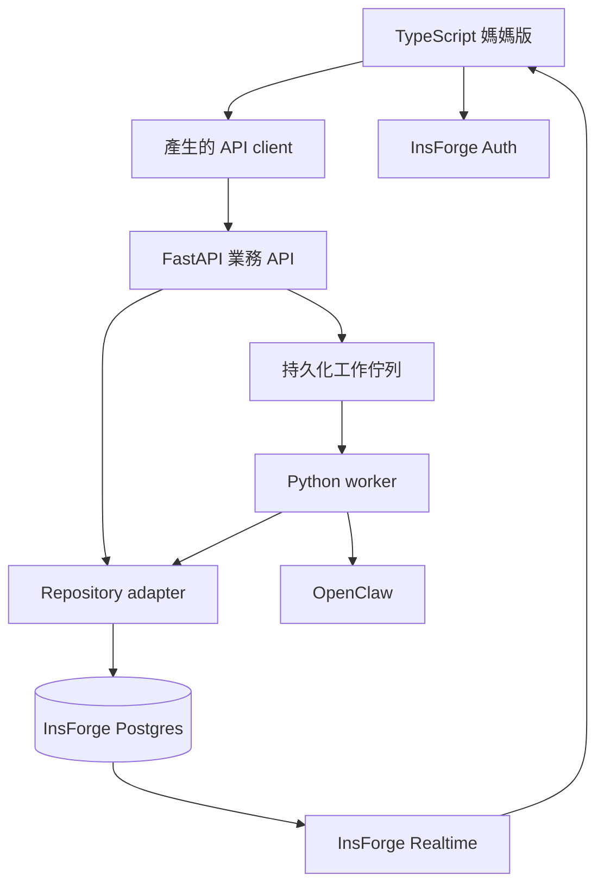

# Travel Mom 漸進式優化提案

日期：2026-09-23。狀態：根據現有程式碼與官方文件整理的提案，尚未實作或連接雲端專案。

目標：保留已有的旅行業務邏輯，以 TypeScript 改善介面與 API 串接，逐步導入 InsForge，讓媽媽能從建立案件一路完成查價、選方案和準備客戶回覆。

使用者提到的「typescript jev api」仍待釐清。以下先提出 TypeScript 使用既有 API 的路線；JEV 是否是特定框架、是否指 Hey API，以及是否希望新增 TypeScript 後端，都尚未確定。

## 現況與優先問題

| 現況 | 影響 | 建議 |
| --- | --- | --- |
| 媽媽版使用原生 JavaScript、字串模板及集中式事件處理 | 新增結果比較、選方案等互動時難以維護 | 逐步轉成 TypeScript，按案件、引導、搜尋、回覆分模組 |
| 大多數 FastAPI 路由沒有 response_model 或回傳型別 | 即使產生 TypeScript client，也無法取得完整的回應型別 | 先補齊請求、回應及錯誤模型 |
| 媽媽版只能建立搜尋及查看進度 | 比較、選擇與驗價需要切換到管理介面 | 優先補上同一案件內的完整流程 |
| 查價用 FastAPI BackgroundTasks，在 API 程序內執行 | 已存任務紀錄不代表程序重啟後能自動恢復 | 建立持久化工作佇列與獨立 worker |
| SQLite SQL 直接寫在 repositories.py | 雲端資料庫遷移需要調整交易與查詢，不能只換網址 | 抽出 repository 介面並新增 InsForge adapter |
| 所有操作者使用同一個 admin token | 缺少個人登入及操作歸屬 | 導入 InsForge Auth 與工作區成員授權 |
| AI 連線徽章只讀 enabled 設定 | 設定啟用不代表 Gateway 可用 | 區分未設定、已設定、連線正常與連線失敗 |
| 行程、簽證、報價等主要是 Skills 工作指引 | 功能入口與真正可完成的事情有落差 | 完整接通一條工作流程後，再逐一產品化 |

程式依據：`app/main.py`、`app/db.py`、`app/repositories.py`、`app/security.py`、`app/mom_static/app.js`。

## 建議分工

| 層次 | 責任 | 處理方式 |
| --- | --- | --- |
| TypeScript 前端 | 媽媽版案件、表單、結果比較、選方案、進度及回覆 | 逐頁替換，第一階段可先採 TypeScript + Vite；是否加 React 另依介面需求決定 |
| TypeScript API client | 請求與回應型別、錯誤呈現、認證、取消請求 | 從 FastAPI OpenAPI 產生；Hey API 是候選工具，並未假定就是使用者所指的 JEV |
| FastAPI 業務 API | 案件命令、查價、選擇、驗價、人工確認及回覆 | 保留既有邏輯，按功能拆分路由 |
| Python worker | 執行既有 BrowserTask、驗證結果、記錄嘗試與恢復任務 | 呼叫現有服務，從持久化佇列領取工作 |
| InsForge | 身分、Postgres、附件儲存及即時事件 | 分階段導入，不另建一套與 Python 脫節的案件資料 |
| OpenClaw | 對話草稿與受限的官網瀏覽 | 維持既有整合，另做真實網站測試 |

若使用者希望 TypeScript 也負責後端，優先評估一層薄的前端專用 API，處理 session 或聚合查詢；避免同時在 Python 和 TypeScript 各維護一套價格驗證與訂購規則。

## 目標資料與呼叫路徑

這是遷移完成後的目標架構，並非目前已連線的狀態。實施初期仍使用現有 SQLite。

- 每一個環境只使用一份權威案件資料庫。遷移期間不讓 SQLite 與 Postgres 同時接收同一批案件的寫入。
- 建案、選方案、接受價格變動及任務狀態更新，都經過業務 API 或 worker。前端不能直接修改資料表來略過業務驗證。
- InsForge Auth 驗證身分；FastAPI 驗證 token 並判斷工作區存取權。資料庫與即時頻道也需配置對應授權，登入成功本身不代表能存取所有案件。
- Python adapter 可透過 InsForge REST 存取資料；涉及多筆資料一致性的操作使用經驗證的交易方式，例如 Postgres function/RPC。不能把一次交易拆成幾個互不保證成功的 HTTP 寫入。
- Realtime 傳遞已保存的變更通知；重新連線後仍從 API 讀取完整狀態。通知不是任務佇列，也不是案件的唯一紀錄。
- 附件功能有明確需求時再使用 Storage；檔案與案件的關聯及存取權由後端管理。
- 官網瀏覽工作保留在可維持瀏覽器 session 的 worker。執行位置需配合實際 OpenClaw 主機，不能假定搬到 Edge Function 就能延續瀏覽器。

## 第一階段：TypeScript 與一條完整工作流程

先保留資料儲存方式，完成以下交付物：

1. 建立可重現的 Python 依賴環境並重跑現有測試，記錄實際基準。
2. 為案件、引導、搜尋進度、比較、選擇及驗價端點補上回應模型；用具體 patch model 取代任意 dict。
3. 建立 OpenAPI 匯出和 TypeScript client 產生指令，CI 檢查規格、client 與後端保持一致。
4. 在獨立路徑提供 TypeScript 媽媽版，逐頁替換既有入口；管理工作台持續供診斷使用。
5. 從案件自動帶入已知需求。城市名稱與 IATA 機場代碼需要明確轉換／選擇，不能把「東京」直接當機場代碼傳入。
6. 接通「案件 → 建立機票查詢 → 查看結果 → 選擇方案 → 重新驗價 → 確認變動 → 人工接手」。飯店沿用同一互動模式。
7. AI 未啟用時顯示可理解的狀態；草稿失敗訊息不能被當成可傳給客人的草稿或學習回饋。

驗收：媽媽可以在主要介面完成上述流程；重整後保留案件與已選方案；不必進入 `/admin` 才能看結果。離線 fixture 與真實網站測試分開記錄。

## 第二階段：InsForge 帳號與資料遷移

1. 確定使用既有或新建 InsForge 專案，以及雲端或自架部署方式。
2. 建立登入、單一旅行社工作區及明確成員關係；先支援實際操作者，不預設擴充成多租戶 SaaS。
3. 建立 Postgres schema migration、repository adapter，以及同一套行為驗證。
4. 以測試資料演練遷移：保留 case/run/task ID、父子關係、選項、回饋、稽核與時間資訊，明確處理日期、JSON、布林及加密欄位。
5. 正式切換採「暫停舊庫寫入 → 備份 → 匯入 → 核對資料與關聯 → 切換服務 → 開放寫入」。
6. 切換後若已產生新資料，回復舊庫前必須處理新增資料，不能僅把設定切回 SQLite。

驗收：兩個裝置登入後看見同一份案件；未授權帳號不能讀寫案件；重要資料的筆數、ID 及關聯核對一致；回復程序完成演練。

## 第三階段：查價可靠性與即時進度

- 任務原子領取、租約與心跳；重複按開始不會同時啟動兩個相同工作。
- worker 中斷後識別過期租約，將可重跑的查詢恢復為待處理；需要登入、驗證碼或人工確認的工作回到人工接手狀態。
- 在使用同一個瀏覽器 profile 時控制併發，避免不同查詢互相操作同一個分頁。
- 使用 InsForge Realtime 更新進度；斷線重連會重新查詢，保留手動更新或輪詢備援。
- 任務成功與失敗都有嘗試紀錄、時間及可理解的原因。

驗收：重啟 API／worker 不會使查詢永久停在 running；重複開始、事件遺漏與網路中斷都有可重現的測試。

## 後續產品優化

完成主要工作流程後，再依實際使用決定報價單、行程編輯、附件、LINE 操作及回覆偏好的優先順序。既有 Skills 可作為需求參考，不能以指引檔存在就宣告功能完成。

## 尚待釐清與驗證

- 「typescript jev api」的確切意思。
- InsForge 專案及部署方式；本次 plugin 目錄查詢沒有找到 InsForge plugin，不代表官方 CLI／MCP 不可使用，也尚未確認任何帳號或專案的連線。
- 真實 OpenClaw 主機與 Browser session 的可用性。
- 本次只有文件和程式碼檢視，沒有重跑測試或驗證雲端功能。舊報告的 62 tests passed 不作為本輪實測結果。

## 官方參考資料

- [InsForge 概覽](https://docs.insforge.dev/introduction)：資料庫、Auth、Storage、Realtime 與 Functions 的平台分工。
- [InsForge Database](https://docs.insforge.dev/core-concepts/database/overview)：Postgres、REST、RLS 及 migrations。
- [InsForge Authentication](https://docs.insforge.dev/core-concepts/authentication/overview)：使用者 session 與 JWT。
- [InsForge Realtime](https://docs.insforge.dev/core-concepts/realtime/overview)：即時事件與訂閱。
- [InsForge TypeScript SDK](https://github.com/InsForge/InsForge-sdk-js/blob/main/SDK-REFERENCE.md)：SDK、REST/RPC 對應能力。
- [FastAPI：產生 TypeScript SDK](https://fastapi.tiangolo.com/advanced/generate-clients/)：透過 OpenAPI 產生 client 的做法。
